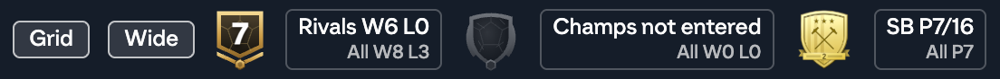
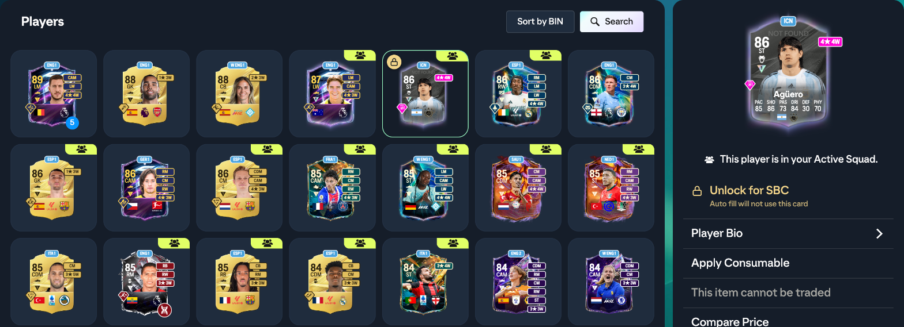
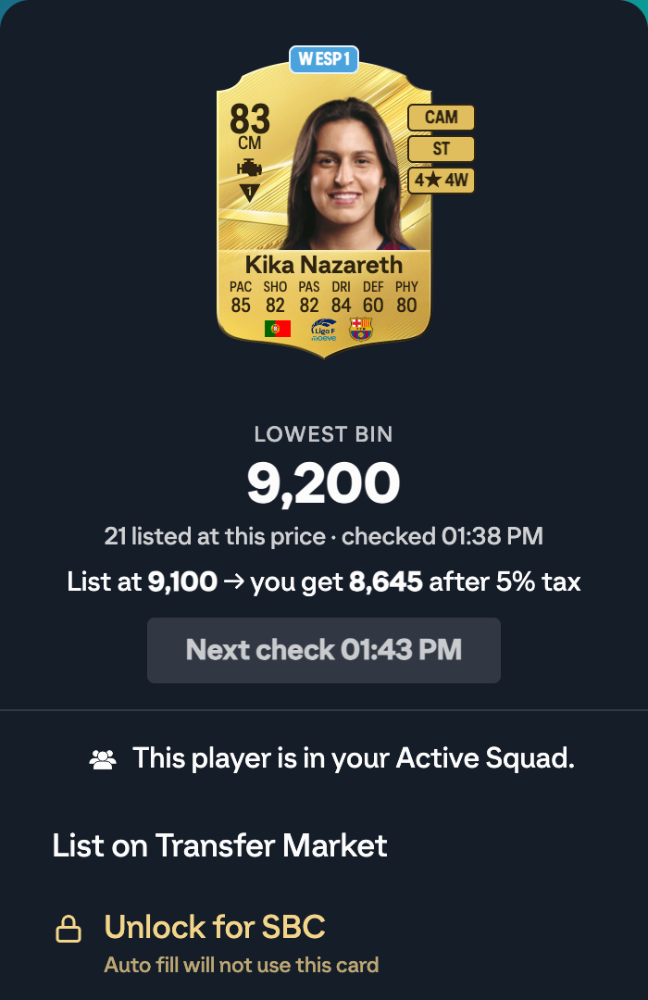
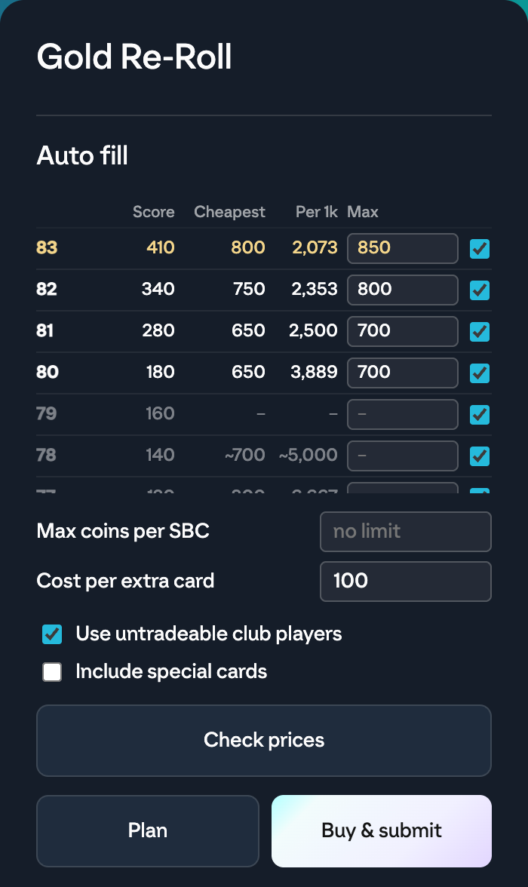
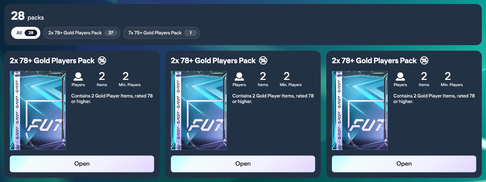

# FC 27 Web App Toolkit

A Chrome extension that adds tools to the [EA SPORTS FC 27 Ultimate Team Web App](https://www.ea.com/ea-sports-fc/ultimate-team/web-app/).
It runs only on that page and uses the Web App's own requests to EA. It sends no data anywhere else.

Not affiliated with or endorsed by Electronic Arts.

## Warning

Some features automate the transfer market: the **Sniper**, the **Buy Now** shortcuts (G, H) that confirm the
purchase themselves, **SBC Auto fill**, which buys players and submits the challenge, and **Sort by BIN**, which
runs many market searches. EA's User Agreement forbids automated
use of the Web App. Heavy use can trigger EA's captcha check, a transfer market ban or an account ban. Use these
features at your own risk.

## Install

Requires Google Chrome, or another Chromium browser that supports Manifest V3 extensions.

1. Download the code: `git clone <repository URL>`, or **Code > Download ZIP** on GitHub and unzip it.
2. Open `chrome://extensions` and turn on **Developer mode** (top right).
3. Click **Load unpacked** and select the project folder, the one that contains `manifest.json`.
4. Open the Web App and log in. The toolbar icon is active on the Web App and grey on every other page.

To update, run `git pull` (or download the ZIP again), then click the reload icon on the extension's card in
`chrome://extensions`, and reload the Web App tab.

## Features

### Header

- **Match stats** next to coins and FC Points:
  - **Rivals:** wins and losses this week.
  - **Champions:** wins and losses in the current stage, or "not entered" / "done".
  - **Squad Battles:** games played this week.
  - **All** below each one: the totals since the extension started tracking on this browser profile.
  - Click any box to refresh. Hover for details.
- **Rivals division** shield with the division number. Hover for the next division and promotion or relegation matches.
- **Champions rank** shield with the rank of the last tracked run (rank = 16 − wins). It is grey when no finished run is saved.
- **Squad Battles rank** badge, using EA's own rank images. Hover for points and points to the next rank.
- EA's top bar is hidden to give the app more room.

The Web App only reports the current week or stage, so the totals and the Champions rank cover only what the
extension saw. Open the Web App after playing to keep them complete.

### Layout toggles

Two buttons in the header, remembered per browser profile:

- **Grid:**
  - Club > Players becomes a grid of square card cells, with 90 players per page.
  - **←** and **→** turn the pages.
  - Squad and SBC club searches are not affected.
- **Wide:**
  - Removes the app's width limits.
  - Squad cards grow to the largest size at which they don't overlap.
  - SBCs show in three columns.
  - Store > Packs shows the packs in three columns, in every tab, with each tile's buttons along its bottom.
  - On Search the Transfer Market, the category tabs become icon buttons before the name field.

### Player cards

Every player card shows, on its right edge, in the card's own colors:

- the alternative positions;
- skill moves and weak foot;
- the league, with "W" in front for women's leagues.

### Prices

- **Lowest BIN** button in the panel of any tradeable card:
  - It searches the market with a falling Buy Now cap until no cheaper listing is left. That takes at most 6 searches, and your own listings are ignored.
  - It shows the lowest Buy Now and how much you get after EA's 5% tax.
  - Results are kept for 5 minutes.
- **Fill** button under **List on Transfer Market**, after a Lowest BIN check: it sets Buy Now to the lowest price and Start price one step below.
- **Sort by BIN** on Club > Players:
  - It checks the lowest Buy Now of every tradeable player, one at a time with pauses, then sorts them highest first.
  - Each card gets a price label.
  - The order stays when a player leaves the list (listed, quick sold, sent to the squad or the Transfer List).
  - Expect about 2 searches per player. Click again to stop.

### Player locks

- **Lock for SBC** at the top of the panel of a player you own (club or squad) keeps that card out of SBC Auto
  fill. Click **Unlock for SBC** to allow it again.
- Locked cards show a lock badge in club lists.
- Locks are kept per card, in `chrome.storage.local`.

### Transfer List

- Active Transfers come first; the other sections keep their order.
- Every section shows two items per row.
- Your own listings show a **profit** label and frame:
  - **green** for a gain, **red** for a loss;
  - profit = sale price after the 5% tax minus what you paid;
  - a card from a pack or reward counts as paid 0.
- EA does not return the paid price of a sold card. The extension remembers it while the card is listed, so a card sold before the extension saw it has no label.

### SBC Auto fill

An **Auto fill** panel under the requirements of a one-click score SBC (for example Gold Re-Roll). It covers the
score with your untradeable players first, then buys the cheapest mix of cards and submits the challenge. Any
required score works, from Gold Re-Roll's 1,250 to 20,000 and more.

| Column | Meaning |
|---|---|
| Rating | Every gold rating up to the challenge's OVR max, then Silver and Bronze |
| Score | EA's score for a regular card of that rating |
| Cheapest | Lowest Buy Now found by **Check prices**; "~" is an estimate from EA's market averages, "–" is unknown |
| Per 1k | Coins per 1,000 score at the row's Max; the best value row is gold |
| Max | Highest price paid for that rating. Check prices sets it one price step above the cheapest; type your own to override |
| Tick | Allows buying that rating |

| Setting | Meaning |
|---|---|
| Max coins per SBC | The plan stops when it needs more coins; empty means no limit |
| Cost per extra card | Added per bought card when plans are compared, so fewer purchases win a close call (default 100) |
| Use untradeable club players | Uses your fodder before buying |
| Include special cards | Lets the fodder include special cards (off by default) |

- **Check prices** searches the top allowed rating, the three best value ratings by estimate and Bronze (about 10
  to 20 searches). Prices are kept for 30 minutes.
- **Plan** shows which fodder is used and what is bought, with the most it can cost. It sends no market request.
- **Buy & submit:**
  - It buys the listings Check prices saw first. Then it searches up to 6 times, alternating the players seen at
    that rating with the general search. EA cannot search by rating, so a general search shows a given rating
    only by chance.
  - It buys at most 5 cards at a time (Unassigned's limit), submits them with the fodder and plans again until the
    challenge completes. EA keeps a partial score between submits.
  - The reward pack stays unopened in **My Packs**.
- **Fodder** is untradeable, rated at most the OVR max, not in the active squad, not locked for SBC, not on loan,
  not limited-use, not in an evolution, and not special unless allowed.
- **Stops:**
  - It stops at the first refusal from EA and says where it stopped. A listing already sold is skipped.
  - Players bought in a stopped run wait in Unassigned and are used first next time, also after a reload.
  - After EA says "too many requests" (status 521 or 429), buying and Check prices pause for 60 minutes. Rounds
    that need no buying still run.

### My Packs

Store > Packs > My Packs gets a header with the number of packs and a filter chip per pack name, each with its
count. A chip shows only that pack; **All** shows every pack again.

### Keyboard shortcuts

You can always check the current keys in **Shortcuts** in the left menu. The window lists every shortcut with its key,
lets you change a key (letters and digits) and restores the defaults below. Keys do nothing while you type in a
field.

| Key | Action | Where |
|---|---|---|
| V | Lowest BIN check | Player panel of a tradeable card |
| C | Send to My Club | Player panel |
| Z / X | Bid Price Min − / + | Search the Transfer Market |
| Q / W | Buy Now Price Max − / + | Search the Transfer Market |
| S | Search | Search the Transfer Market |
| A | Back | Any screen with the back arrow |
| G | Buy Now the **last** shown card and confirm | Search results |
| H | Buy Now the **first** shown card and confirm | Search results |
| ← / → | Previous / next page (fixed keys) | Club > Players |

### Rating filter

EA's transfer market cannot search by rating. The **Rating** row in the panel above Reset and Search on Search
the Transfer Market filters the listings EA returns instead. It is off until you tick **On**; while off, none of
the following applies.

| Setting | Meaning |
|---|---|
| On | Turns the Rating filter on for searches, the sniper and Find cheapest |
| Min / Max | Rating range, 40 to 99; empty means no limit (Min 84 and Max 84 = exactly 84) |
| By player | Searches the players whose card has a rating in the range, one player at a time, in turn |
| Find cheapest | Finds the lowest Buy Now in the range (up to 8 searches) |

- **Search Results** hides other sellers' players outside the range and says how many of the page are shown.
  When the selected listing is hidden, the first shown one is selected; when none is shown, the side panel is
  hidden too.
- **Gold only:** with a Min of 75 or more and no Quality in the form, searches are Gold only, because bronze and
  silver cards are never rated that high.
- **More pages:** when a page has no match, the next page opens by itself, up to 5 more pages (one search each).
  Turning a page yourself stops this.
- **Find cheapest** starts at your Buy Now Max (or 1,000), raises the cap until cards in the range appear, then
  lowers it below the cheapest one until none is left, and reports the lowest price found.
- **By player** uses the app's player database. Each Search press checks players in turn (up to 10 per press,
  one search each) and shows the first one with a listing in range. It knows each player's regular card only, so
  a special card rated higher than the player's own is missed.
- **Not on market:** a player with no listing in range is searched once more without any limit. With no listing
  at all, he is saved as not on market for 7 days and skipped by Search and the sniper.
- The sniper buys only listings in the range, and in By player mode takes the next player with each search.

### Sniper

A panel above Reset and Search on Search the Transfer Market. It repeats the search you set in the form.

| Setting | Meaning |
|---|---|
| Run (s) | Total running time, 10 to 3,600 seconds |
| Wait (s) | Pause after each search, 1 to 60 seconds |
| Buy last found | Buys the last listing in each non-empty result at its Buy Now price |
| After buy | **List at lowest BIN:** runs the Lowest BIN check, then lists the card for 1 hour, Buy Now = lowest, Start = one step below. **Send to Transfer List:** moves it there unlisted. **Keep in Unassigned:** does nothing else. |

- **Fresh results:** each search changes only Bid Price Min, through the next price steps below Buy Now Max, so EA returns fresh results instead of a cached answer. Listings that started below that minimum are hidden from that one search.
- **Safety limits:**
  - It does not start without **Buy Now Price Max** while buying is on.
  - It never buys your own listings, or anything above the cap.
- **It stops** when:
  - the time is up, or you press Stop;
  - EA refuses a search or asks for a captcha (solve it yourself in the app);
  - a buy fails for a reason other than the card being already sold.

## Data and permissions

- `storage`: settings, shortcut keys, match history, paid prices, the players saved as not on market and the
  locked cards are kept in `chrome.storage.local` on this computer only.
- SBC Auto fill keeps its checked prices, the cooldown end time and the bought players waiting in Unassigned in
  the page's `localStorage`.
- `declarativeContent`: greys out the toolbar icon outside the Web App.
- The scripts run only on `https://www.ea.com/ea-sports-fc/ultimate-team/web-app/*`. Most of them run in the page itself, so they can use the Web App's own services.

## Project layout

| File | Purpose |
|---|---|
| `manifest.json` | Extension manifest (Manifest V3) |
| `src/background.js` | Toolbar icon active only on the Web App |
| `src/storage-bridge.js` | Gives the page scripts access to `chrome.storage.local` |
| `src/wide-mode.js` | Grid and Wide toggles, squad card sizing, market tab labels |
| `src/content.css` | All styles |
| `src/match-stats.js` | Header stats, division, rank badges, history |
| `src/card-info.js` | Positions, skill moves, weak foot and league on cards |
| `src/price-check.js` | Lowest BIN check and the Fill button |
| `src/shortcuts.js` | Keyboard shortcuts and the Shortcuts window |
| `src/club-list.js` | Club > Players grid page size and arrow keys |
| `src/club-sort.js` | Sort by BIN |
| `src/sniper.js` | Sniper and the Rating filter |
| `src/transfer-list.js` | Transfer List profit labels |
| `src/sbc-helper.js` | SBC Auto fill |
| `src/player-lock.js` | Lock for SBC |
| `src/store-packs.js` | My Packs count and filter |
| `icons/` | Toolbar and extension icons |
| `docs/screenshots/` | Images used in this README |

The extension relies on the Web App's internal classes and page structure. An EA update to the Web App can break
a feature until the code is adjusted.
